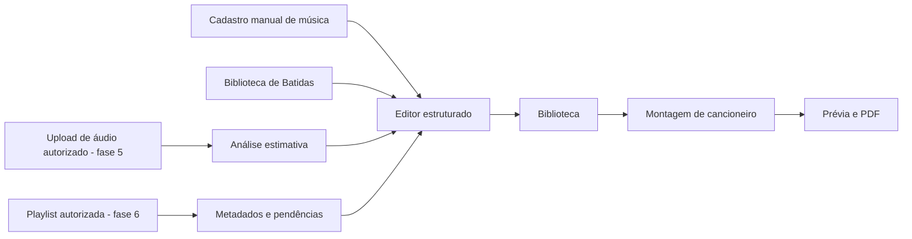

# 01 — Visão de produto e escopo

**Projeto:** StrumLab · **Tagline de trabalho:** *Da música ao seu cancioneiro.* · **Versão:** 1.1.

## Proposta

Plataforma web/PWA de apoio ao violonista, reunindo **editor de cifras**, **organização pessoal**, **cancioneiros imprimíveis** e **treinamento de batidas com demonstração sonora de violão**. O produto poderá evoluir para análise de arquivos de áudio (BPM, tonalidade e acordes) e processamento de playlists, sem prometer transcrição perfeita ou acesso irrestrito a obras.

## Problemas a resolver

- Músicas e cifras distribuídas em arquivos, notas ou páginas difíceis de editar/reunir.
- Necessidade de transpor acordes, revisar posições e montar cancioneiros legíveis para ensaios e apresentações.
- Dificuldade em compreender batidas por indicação textual sem áudio e referência visual.
- Tempo gasto identificando acordes e ritmo manualmente em gravações (problema a abordar **após o MVP**).

## Públicos e jornadas

| Público | Jornada principal | Fases |
|---|---|---|
| Violonista | Cria/importa texto autorizado da cifra, ajusta acordes, tom/capo e salva | 2 |
| Organizador musical | Seleciona músicas, define ordem, escolhe capa/layout e exporta PDF | 3 |
| Aprendiz | Pesquisa modelos Pop/Folk e outros, regula BPM, ouve violão e vê as setas animadas | 4 |
| Músico que estuda gravações | Envia arquivo permitido e revisa sugestões de análise | 5 |
| Responsável por repertório extenso | Importa metadados de playlist, resolve pendências e monta cancioneiro | 6 |

## Pilares

1. **Correção humana:** qualquer resultado automático é editável, reversível e explicitamente estimado.
2. **Fonte única de estrutura musical:** dados semânticos de cifra alimentam editor, transposição, diagramas e PDF.
3. **Preparado para uso real:** arquivos imprimíveis, legibilidade e persistência são centrais, não acessórios.
4. **Aprendizado auditivo e visual:** setas e som compartilham a referência temporal, com som próximo de violão real.
5. **Direitos e permissões:** conteúdo de terceiros requer fonte/uso apropriados; playlist não fornece automaticamente áudio.

## Escopo por lançamento

- **Primeiro MVP (fases 1–4):** criar/editar cifras manualmente, biblioteca pessoal, transpor/capo, cancioneiro/PDF e biblioteca inicial de batidas (Pop/Folk obrigatório).
- **Versão com análise (fase 5):** MP3/WAV/gravação autorizados, jobs, resultados aproximados e aprovação/revisão.
- **Versão com playlist (fase 6):** importação autorizada de metadados, itens pendentes e processamento independente.
- **Futuro, sem compromisso:** separação de stems, detecção avançada de seções, tablaturas/solos aproximados, colaboração, app nativo.

## Exclusões explícitas

- Transcrever perfeitamente solos, dedilhados, acordes complexos ou letras a partir de qualquer áudio.
- Baixar áudio de YouTube/Spotify ou copiar letras por scraping sem autorização.
- Tratar padrões de batida como transcrição comprovada de uma música.
- Disponibilizar catálogo público com letras protegidas sem licenciamento.
- Construir app nativo, sistema social ou marketplace no MVP.

## Visão do fluxo

## Resultados a medir (metas propostas, ainda não validadas)

- Jornada manual completa sem falhas: criar música, reabrir, transpor, adicionar a cancioneiro e exportar PDF.
- Zero perda de conteúdo estruturado após salvar/reabrir e após transpor + desfazer.
- A batida Pop/Folk executa em loop sem duplicar áudio após pausa/retomada.
- Toda análise automática exibe seu caráter estimado e permite correção.

## Identidade e apresentação

Nome definitivo informado: **StrumLab**. Tagline, paleta e logotipo são **propostas**; não presumir domínio ou marca registrada disponível. Visual: moderno, músico, claro para iniciantes, desktop-first para editor com experiência móvel funcional.
