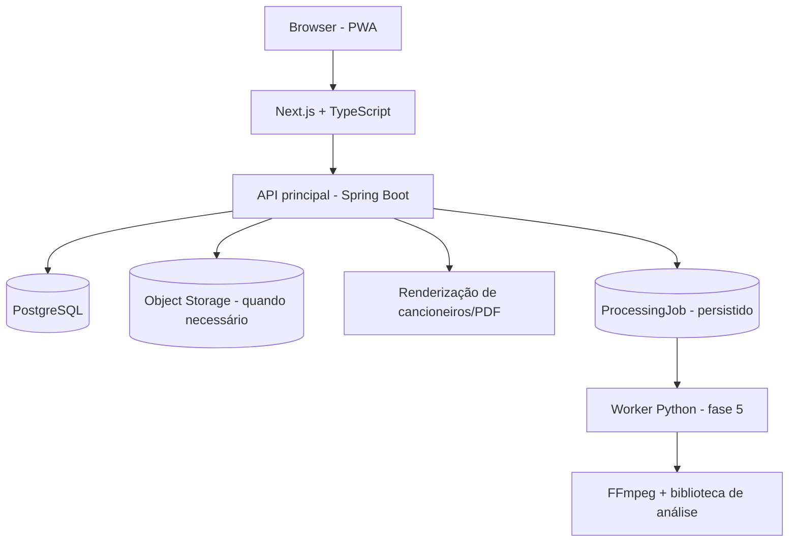

# 03 — Arquitetura, tecnologia e ambientes

## Situação das escolhas

Esta seção expressa **recomendações técnicas**, não escolhas já confirmadas pelo responsável. O backend Java 21/Spring Boot é o caminho recomendado para manter consistência com experiência prévia em Java. Registrar validação final em `docs/12-decisoes.md` antes de gerar o scaffold.

## Arquitetura proposta



### Componentes

| Camada | Proposta | Introdução | Observação |
|---|---|---|---|
| Web | Next.js, React, TypeScript | Fase 1 | PWA habilitada quando houver benefício real de offline/cache |
| UI | Tailwind CSS, shadcn/ui ou biblioteca acessível equivalente | Fase 1 | Não comprometer acessibilidade por estética |
| API | Java 21, Spring Boot, Bean Validation, Spring Security | Fase 1 | Configuração de segurança mesmo em modo local |
| Persistência | PostgreSQL, Flyway | Fase 1 | Evitar ORM criando schema automaticamente em produção |
| Contratos | OpenAPI 3, DTOs tipados | Fase 1 | Fonte de verdade única para API; versionamento `/api/v1` |
| PDF | Serviço de renderização a definir por spike | Fase 3 | Determinismo visual e fonte Unicode/acordes/setas |
| Áudio interativo | Web Audio API | Fase 4 | Browser audio graph, buffers e clocks |
| Análise musical | Python Worker, FFmpeg, librosa e/ou Essentia | Fase 5 | Evaluar qualidade em dataset antes de fixar algoritmo |
| Objetos | S3-compatível ou equivalente | Fase 5 / PDF opcional | Provedor não escolhido |
| Jobs | PostgreSQL com lease/worker simples inicialmente | Fase 5 | Redis/broker apenas com justificativa de volume |

## Monorepo recomendado (proposta)

```text
apps/
  web/                        # Next.js + TypeScript
  api/                        # Spring Boot - modular monolith
workers/
  music-analysis/             # adicionado apenas na Fase 5
packages/
  contracts/                  # gerado/versionado quando útil
infra/
  compose.yaml
  docker/
docs/                           # fonte de verdade desta versão
prompts/
```

## Estratégia incremental

- **Fases 1–4:** monólito modular na API; lógica de editor/catálogo/PDF separada por feature; motor de batidas no frontend sem backend de streaming.
- **Fase 5:** processamento musical CPU-bound separado em processo worker; API registra jobs e fornece status. Evitar `await` bloqueante longo ou processar FFmpeg na thread HTTP.
- **Fase 6:** integração de playlist usa adaptadores de provedores, paginação/cotas e jobs independentes; nenhum provider é requisito para fase 1.

## Domínios/módulos sugeridos

- `songs`: músicas, revisões, editor, transposição.
- `songbooks`: coleções, itens, snapshots e exportação.
- `strumming`: catálogo e associação de padrões; player executado na web.
- `analysis`: assets, jobs e sugestões (fase 5).
- `integrations`: provedores externos/playlist (fase 6).
- `identity`: autenticação, ownership, permissões (modo inicial pendente).

## Contratos básicos (a detalhar na implementação)

Endpoints iniciais **propostos**, não publicados:

```text
GET    /api/v1/health
GET    /api/v1/songs
POST   /api/v1/songs
GET    /api/v1/songs/{id}
PATCH  /api/v1/songs/{id}
POST   /api/v1/songs/{id}/revisions
POST   /api/v1/songs/{id}/transpose
GET    /api/v1/songbooks
POST   /api/v1/songbooks
PUT    /api/v1/songbooks/{id}/items/order
POST   /api/v1/songbooks/{id}/export
GET    /api/v1/strumming-patterns
PUT    /api/v1/songs/{id}/strumming-pattern
POST   /api/v1/songs/{id}/audio-assets        # fase 5
GET    /api/v1/jobs/{id}                      # fase 5
POST   /api/v1/playlist-imports               # fase 6
```

Retornar validações estruturadas (Problem Details), não expor caminhos de storage, tokens ou stack traces. API/DTOs não precisam implementar rotas de fases futuras antecipadamente.

## Estados de autenticação e publicação

**Decisão pendente:** protótipo local de usuário único ou login real desde o início. Se usar protótipo local, proibir hospedagem pública de bibliotecas privadas sob `owner_id` fixo; a mudança para multiusuário exige autorização e controle de acesso testado.

## Ambientes

- `local`: Docker Compose para PostgreSQL, processos web/API com hot reload, dados sintéticos e variáveis `.env` ignoradas no git.
- `test`: banco isolado, fixtures, arquivos pequenos autorizados/sintéticos; nenhuma dependência de API externa real.
- `staging`: criado só após aprovação da estratégia de deploy; autenticação/retensão avaliadas.
- `production`: fora da Fase 1 sem autorização explícita.

## Dados e segurança

UUID para identificadores; timestamps UTC; chaves de storage opacas; limites por usuário; política futura de exclusão. Validar MIME real, extensão, duração e tamanho; evitar path traversal, SSRF na importação de URLs e logs contendo letras/áudio/senhas. Em integrações, tokens apenas em secrets manager/variáveis seguras. Aplicar migrações transacionais; não usar `ddl-auto=update` em ambiente público.

## Pontos de atenção

1. O framework Next.js no frontend **não elimina** a API Java; decidir como lidar com SSR, CORS e proxies localmente.
2. Motor PDF definitivo é **spike da Fase 3**, não declarar escolhido antes do teste de A4, tipografia e Unicode.
3. Motor de violão usa amostras autorizadas; não confundir aplicação de DSP/samples com análise automática de música.
4. Offline PWA pode servir para **dados próprios cacheados**, mas não pressupõe licença de armazenar conteúdo de streaming para acesso offline.
