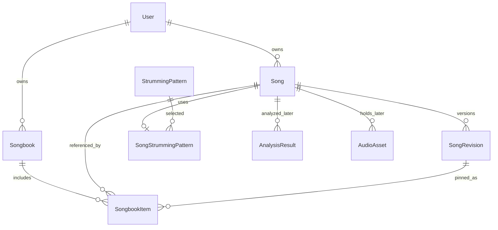

# 04 — Modelo de dados e integridade

## Princípios

- Acordes são dados musicais estruturados, não espaços inseridos sobre letras em texto monoespaçado.
- **Revisão humana imutável:** não perder edições ao aplicar transposição, reprocessar ou exportar.
- **Eventos de acordes temporais** são diferentes de **acordes ancorados em texto**; um não implica automaticamente outro.
- Um cancioneiro mantém ordem e revisões explícitas para reproducibilidade.
- Entidades de áudio/playlist serão adicionadas somente nas fases correspondentes.

## Entidades propostas

| Entidade | Campos essenciais | Fase | Regras |
|---|---|---:|---|
| `User` / `Workspace` | `id`, `name`, `email?`, `created_at` | 1/decisão | Resolver modelo de identidade antes de publicar |
| `Song` | `id`, `owner_id`, `title`, `artist?`, `default_key?`, `bpm?`, `meter?`, `capo?`, `status`, timestamps | 2 | Metadados e ownership |
| `SongRevision` | `id`, `song_id`, `revision_no`, `content_json`, `created_by`, `source`, `created_at` | 2 | Snapshot imutável; fonte `manual/import/analysis_accepted` |
| `SongDraft` (ou equivalente) | `song_id`, `base_revision_id`, `working_content`, `updated_at` | 2 | Conflitos de edição, autosave controlado |
| `Songbook` | `id`, `owner_id`, `title`, `subtitle?`, `cover_config_json`, `layout_config_json`, timestamps | 3 | Proprietário único no MVP |
| `SongbookItem` | `id`, `songbook_id`, `song_id`, `song_revision_id`, `position`, `notes?` | 3 | Revisão explícita; ordem única por livro |
| `SongbookExport` | `id`, `songbook_id`, `manifest_json`, `storage_key?`, `created_at`, `status` | 3 | Snapshot de exportação não mutável |
| `StrummingPattern` | `id`, `slug`, `name`, `style`, `difficulty`, `meter`, `default_bpm`, `events_json`, `version` | 4 | Catálogo didático versionado |
| `SongStrummingPattern` | `song_id`, `pattern_id`, `pattern_version`, `bpm_override?`, `notes?`, `customization_json?` | 4 | Uma seleção ativa no MVP |
| `AudioAsset` | `id`, `song_id`, `storage_key`, `mime`, `duration_ms`, `rights_basis`, `status`, timestamps | 5 | Upload privado e retenção |
| `AnalysisResult` | `id`, `song_id`, `asset_id`, `algorithm_version`, `bpm?`, `key?`, `confidence_json`, `events_json`, timestamps | 5 | **Nunca** sobrescreve revisão humana |
| `ProcessingJob` | `id`, `kind`, `resource_id`, `status`, `progress`, `attempts`, `error_code?`, timestamps | 5 | Idempotência/lease para execução |
| `PlaylistImport` | `id`, `owner_id`, `provider`, `source_url`, `title?`, `status` | 6 | Somente metadados autorizados |
| `PlaylistImportItem` | `id`, `import_id`, `position`, `external_id`, `title`, `artist?`, `song_id?`, `status`, `error_code?` | 6 | Independência dos itens |

**Nota:** `owner_id` depende da decisão de identidade. Em Fase 1 local, usar configuração/test fixture isolada; não deixar dono fixo para deployment público.

## Formato canônico de conteúdo de cifra (exemplo fictício)

```json
{
  "schemaVersion": 1,
  "title": "Canção de exemplo",
  "key": "G",
  "meter": "4/4",
  "sections": [
    {
      "id": "sec-1",
      "type": "verse",
      "label": "Verso 1",
      "lines": [
        {
          "id": "line-1",
          "tokens": [
            {"type": "chord", "symbol": "G"},
            {"type": "text", "value": "Hoje vou "},
            {"type": "chord", "symbol": "D"},
            {"type": "text", "value": "cantar"}
          ]
        }
      ]
    }
  ]
}
```

### Por que tokens, não offsets ou espaços?

Tokens permitem reconstruir a localização do acorde antes de uma palavra, independente de variação de fonte ou tamanho. Evitam ambiguidades de offset em Unicode e tornam transposição localizada nos tokens `type=chord`. Linhas só de acordes também são válidas; texto sempre permanece literal. Ao editar palavras, manter os tokens nos pontos semânticos, com UX definida em `05-editor-cifras.md`.

## Relações e integridade



- Índice único `(song_id, revision_no)`.
- Índice/constraint de ordem `(songbook_id, position)`; rearranjar em transação evitando conflitos intermediários.
- FK `SongbookItem.song_revision_id` deve apontar para revisão pertencente à mesma música (`song_id`); validar no domínio ou via chave composta se viável.
- Restrição de ownership coerente para músicas e cancioneiros; não assumir compartilhamento entre contas no MVP.
- Export guarda `manifest_json`: revisão, configuração, ordem e versão do renderizador.
- Política de exclusão distingue arquivar música, remover item do cancioneiro e apagar dados pessoais. Não aplicar cascata destrutiva a PDFs históricos sem regra de retenção aprovada.

## Revisões e concorrência

1. Usuário abre revisão N; editor cria/atualiza rascunho com `base_revision_id=N`.
2. Salvar produz `SongRevision N+1`, sem mutar N.
3. Se outro editor já criou revisão mais recente, API retorna conflito (`409`) e oferece recuperação; não mesclar silenciosamente.
4. Transposição é operação sobre rascunho ou nova revisão; desfazer/restaurar não apaga histórico.
5. Resultado da análise na Fase 5 é apenas sugestão; aprovação explícita gera nova revisão de fonte `analysis_accepted`.

## Origem e licenças

Para letras, cifra, áudio e amostras de instrumento: armazenar `source_type`, `source_reference` quando pertinente, `rights_basis` e condições de uso; **nunca** pressupor permissão por o conteúdo ter sido enviado/achado na web. Minimizar metadados pessoais e não expor valores sensíveis em logs.

## Padrões operacionais

Timestamps UTC; IDs UUID em persistência definitiva; migrações Flyway; valores de compasso validados; enumeração de acidentes/notação documentada; chaves opacas para blob storage. Conteúdo JSON deve ser versionado (`schemaVersion`) e ter validação (backend/frontend) com migração de formato planejada.

## Complemento v1.1 — proposta
Capturar metadados musicais históricos dentro da revisão e snapshot opcional de batida por SongbookItem na Fase 4. Prévia e exportação devem usar o mesmo manifesto. Ver docs/15-contratos-ux-dados.md antes de definir migrations.
