# 14 — Telas e funcionalidades

Status: especificação visual **proposta**, não aplicação implementada. Abra `../mockups/index.html` em navegador; o seletor e os links navegam entre as telas. Dados fictícios. As imagens abaixo são mockups compostos, não screenshots; os limites de validação estão em docs/17-validacao-mockups.md. Botões sem fluxo implementado ficam desabilitados. Campos alteráveis não persistem. Nenhum som, upload, login, API ou PDF de produto é executado nesta galeria.

## Navegação proposta

Desktop: Início / Músicas / Cancioneiros / Batidas / Preferências. No celular, navegação compacta e conteúdo empilhado. A galeria também mostra Editor, Leitura, Montagem, Prévia e telas futuras separadamente; isso não equivale ao menu final. Fases 5–6 ausentes do menu de produção até estarem disponíveis.

| Tela | Fase | Rota proposta | RF |
|---|---:|---|---|
| Início | 1 | `/` | RF-01 |
| Músicas | 2 | `/musicas` | RF-03, RF-07 |
| Editor | 2 | `/musicas/:id/editar` | RF-04–06 |
| Leitura | 2 | `/musicas/:id` | RF-04, RF-06 |
| Cancioneiros | 3 | `/cancioneiros` | RF-08 |
| Montagem | 3 | `/cancioneiros/:id` | RF-08 |
| Prévia | 3 | `/cancioneiros/:id/previa` | RF-09–10 |
| Batidas | 4 | `/batidas` | RF-11 |
| Prática | 4 | `/batidas/:slug` | RF-12–14 |
| Análise | 5 | `/musicas/:id/analises/:jobId` | RF-16–18 |
| Playlists | 6 | `/importacoes/:id` | RF-19–20 |
| Preferências | 1 | `/preferencias` | RNF-02 |
| Acesso condicional | 1 | `/entrar` | RB-05 |
| Estados | 1 | `sem rota de produto` | RNF-02 |

## 1. Início

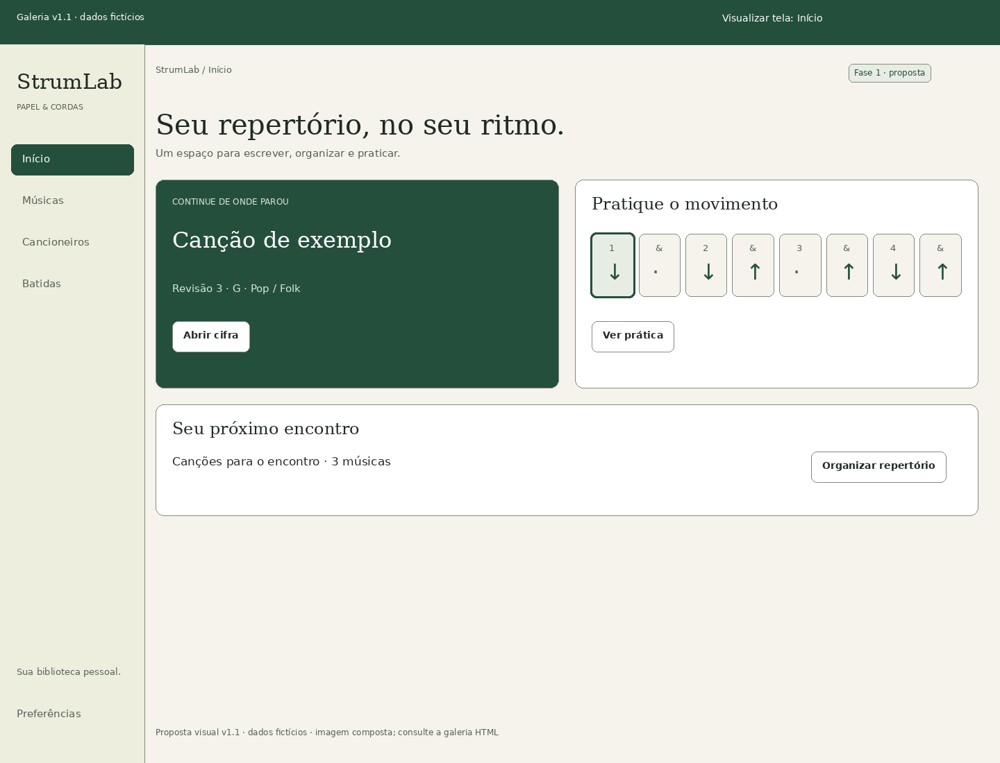

**Objetivo:** Retomar o repertório. **Fase:** 1. **Ação principal:** Criar cifra.

Resumo de músicas, último livro e acesso à prática. Cartões abrem módulos disponíveis. Estatísticas são calculadas de dados reais; zero é válido.

**Regras e estados:** Abrir último item respeita a revisão; novo usuário vê CTA para criar a primeira cifra.

## 2. Músicas

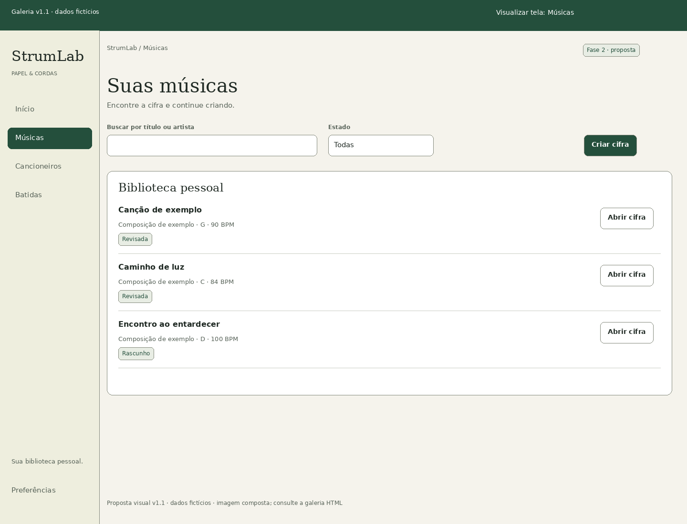

**Objetivo:** Encontrar uma cifra. **Fase:** 2. **Ação principal:** Criar cifra.

Busca por título/artista e filtros de status. Abrir cifra, criar manualmente ou importar ChordPro simples. Arquivar mantém referências em livros.

**Regras e estados:** Busca sem resultados permite limpar filtros. Remover do livro não arquiva a música.

## 3. Editor de cifra

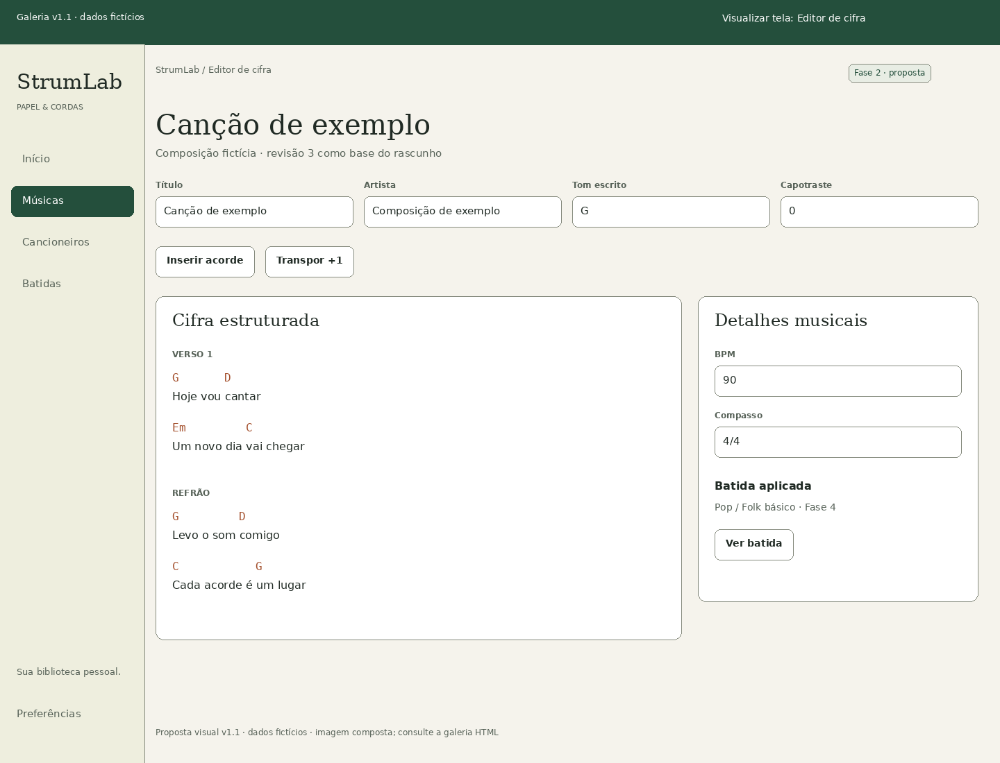

**Objetivo:** Editar e revisar acordes. **Fase:** 2. **Ação principal:** Salvar revisão.

Título, artista, tom escrito, capo, BPM e compasso; seções, tokens, transposição e histórico. Batida contextual só a partir da Fase 4.

**Regras e estados:** Salvar gera revisão imutável; 409 oferece comparar/recarregar/cópia. Capo não transpõe símbolos automaticamente.

## 4. Leitura de cifra

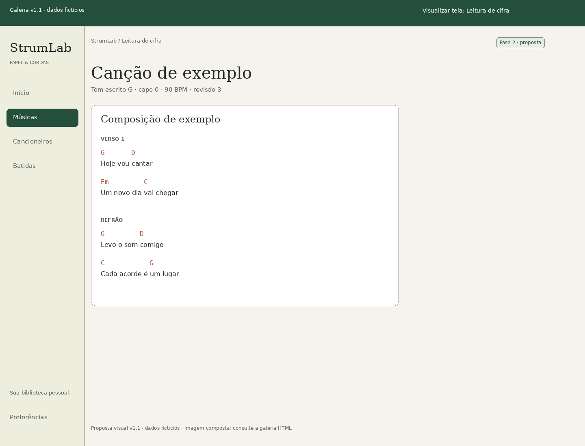

**Objetivo:** Consultar durante o ensaio. **Fase:** 2. **Ação principal:** Editar cifra.

Cifra sem ferramentas de edição, fonte ajustável, tom e capo claramente distintos. Ler revisão explícita; abrir editor para alterações persistidas.

**Regras e estados:** Mudança de tamanho é preferência de leitura. Rolagem automática é futura, sem botão ativo no MVP.

## 5. Cancioneiros

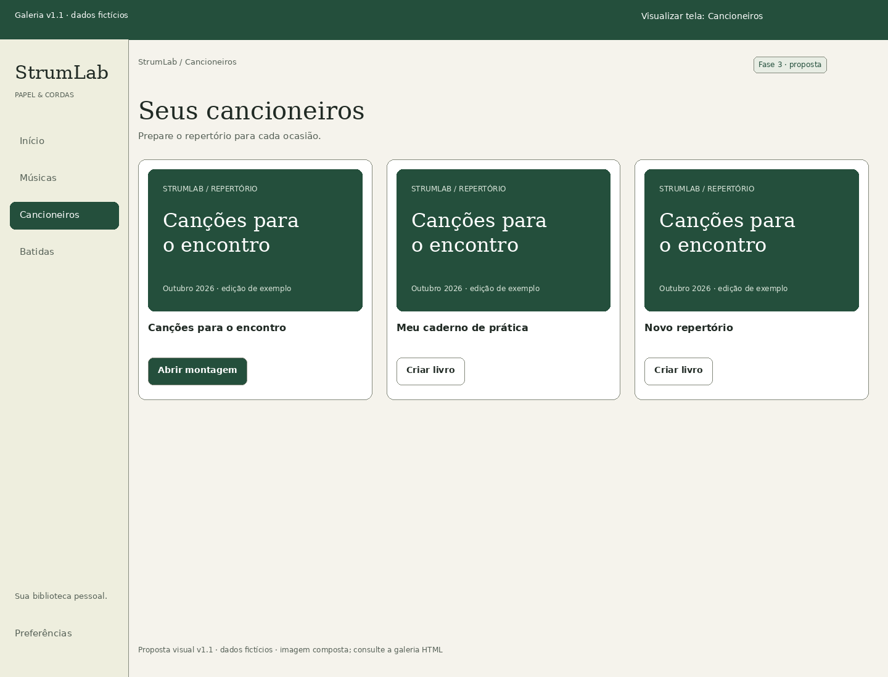

**Objetivo:** Encontrar e criar um livro. **Fase:** 3. **Ação principal:** Criar cancioneiro.

Lista de livros com título, total de itens e data. Abrir montagem, renomear e arquivar sem excluir músicas.

**Regras e estados:** Livro vazio orienta adicionar músicas; exportação sem conteúdo válido fica bloqueada.

## 6. Montagem do cancioneiro

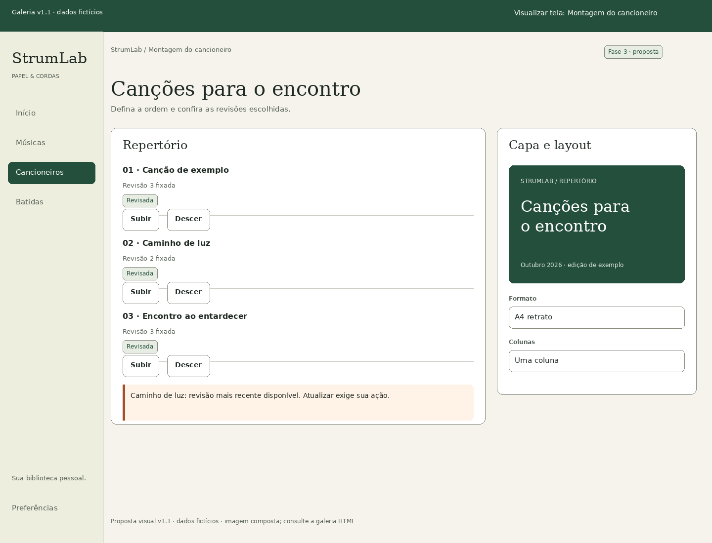

**Objetivo:** Organizar o repertório. **Fase:** 3. **Ação principal:** Ver prévia.

Adicionar da biblioteca, definir ordem, remover item e inspecionar revisão fixada. Subir/descer e drag acessível; duplicar somente por ação explícita.

**Regras e estados:** Revisão mais recente gera aviso com atualização seletiva. Reordenar persiste atomicamente.

## 7. Prévia e PDF

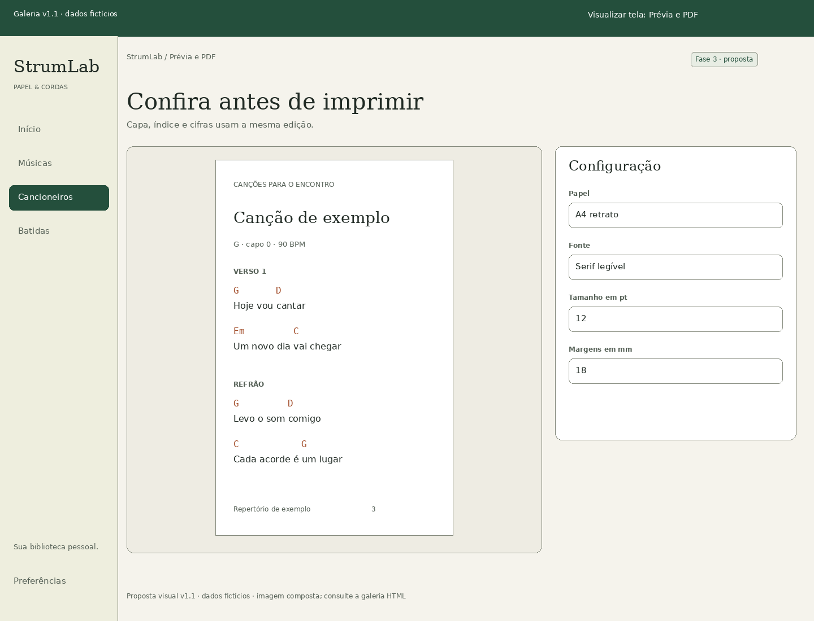

**Objetivo:** Conferir antes de imprimir. **Fase:** 3. **Ação principal:** Exportar PDF.

Capa, índice por ordem, A4 retrato, margens/fonte, uma ou duas colunas. Categoria/paisagem são extensões propostas. Prévia e PDF usam mesmo manifesto.

**Regras e estados:** Durante renderização mostrar progresso indeterminado se não medível. Erro permite repetir; mudança de layout invalida prévia anterior.

## 8. Biblioteca de batidas

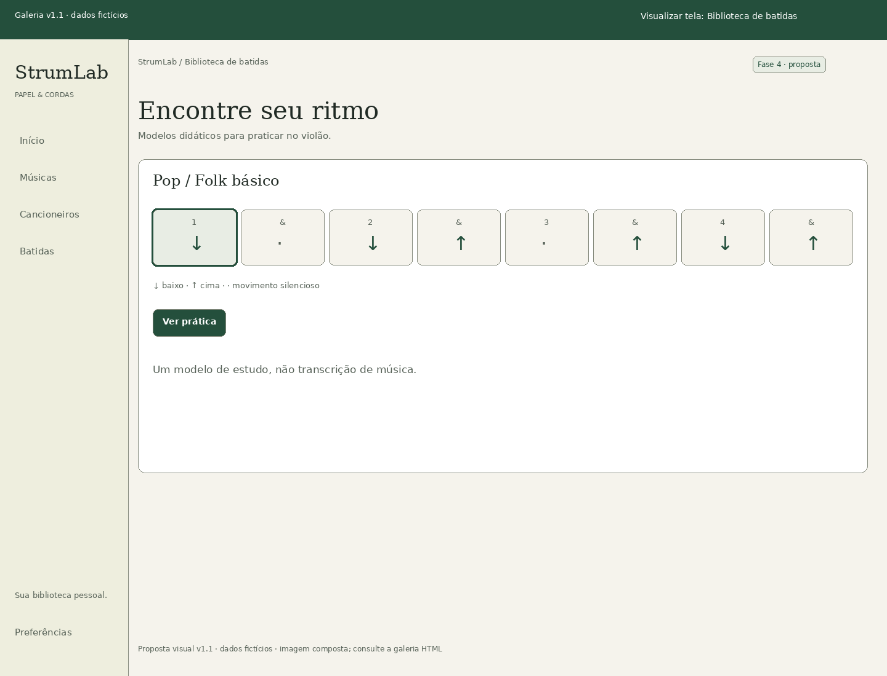

**Objetivo:** Escolher um modelo didático. **Fase:** 4. **Ação principal:** Abrir Pop / Folk.

Pesquisa e filtros por estilo, compasso e dificuldade; Pop/Folk obrigatório. Padrões adicionais só aparecem quando implementados.

**Regras e estados:** Não rotular modelo como batida exata de uma música. Catálogo vazio/erro não bloqueia cifras.

## 9. Prática Pop / Folk

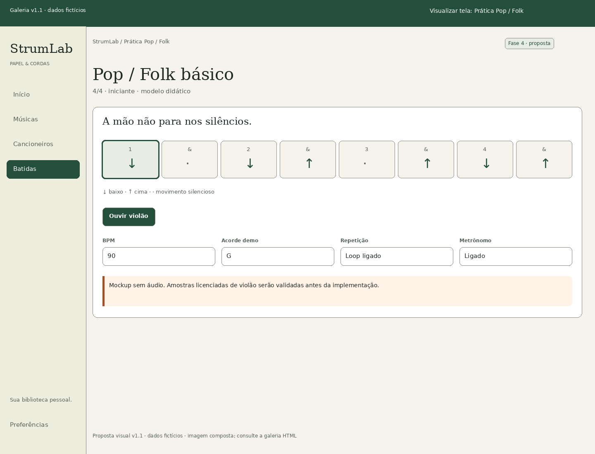

**Objetivo:** Aprender o movimento no ritmo. **Fase:** 4. **Ação principal:** Ouvir violão.

Grade 1 & 2 & 3 & 4 &, BPM 45–160 no protótipo, G/C/D/Em, play/pausa/reinício/loop, metrônomo e ganhos independentes. Aplicar à música cria vínculo.

**Regras e estados:** Slots 1 e 4 silenciosos mantêm movimento. 90 BPM: 8 movimentos, 4 cliques, 6 ataques; pausa não duplica scheduler. Mockup não reproduz áudio.

## 10. Análise de áudio

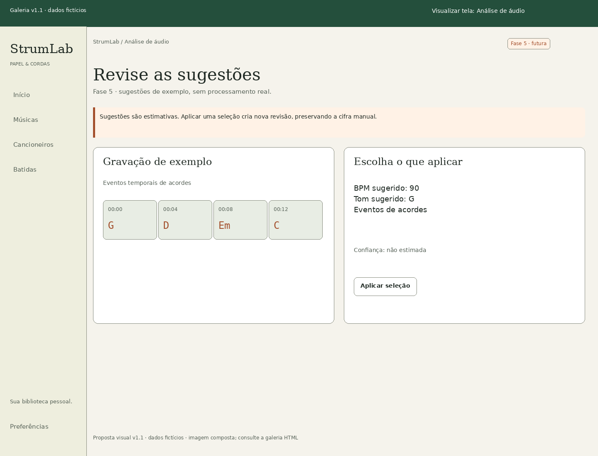

**Objetivo:** Revisar sugestões de gravação. **Fase:** 5. **Ação principal:** Aplicar seleção.

Enviar MP3/WAV autorizado; job e timeline separados da letra; sugestões de BPM, tom e acordes. Aplicar somente itens selecionados cria revisão.

**Regras e estados:** Futuro. Confiança só se calibrada; valor ausente é “não estimado”. Reprocessar não sobrescreve revisão humana.

## 11. Importação de playlist

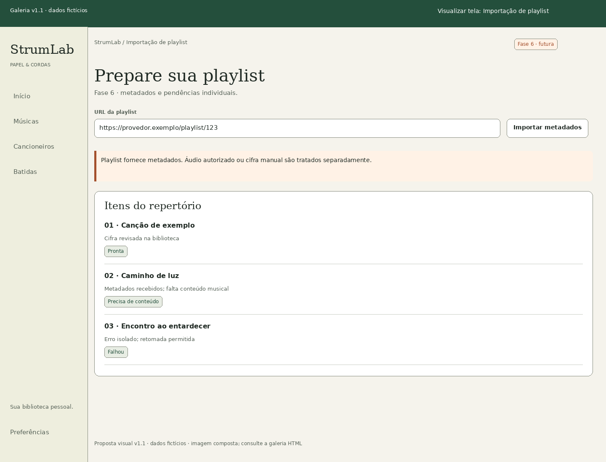

**Objetivo:** Preparar músicas item a item. **Fase:** 6. **Ação principal:** Importar metadados.

URL de provedor suportado, conexão autorizada, seleção, ordem e estados individuais. Arquivo autorizado ou cifra manual resolve falta de conteúdo.

**Regras e estados:** Futuro. Não baixa áudio de streaming nem letras. Duplicata pede reutilizar/pular/copiar; falha isolada permite retomar.

## 12. Preferências

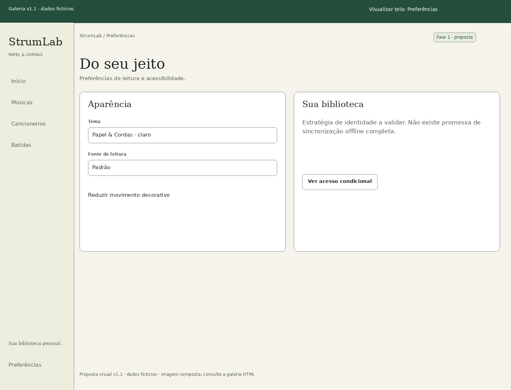

**Objetivo:** Ajustar leitura e acessibilidade. **Fase:** 1. **Ação principal:** Aplicar preferências.

Preferência de contraste, movimento reduzido e leitura. Conta/login apenas após decisão de identidade; retenção de arquivos fica para Fase 5.

**Regras e estados:** Preferências visuais não alteram cifra nem layout de PDFs já exportados. Tema escuro completo é futura proposta.

## 13. Acesso — condicional

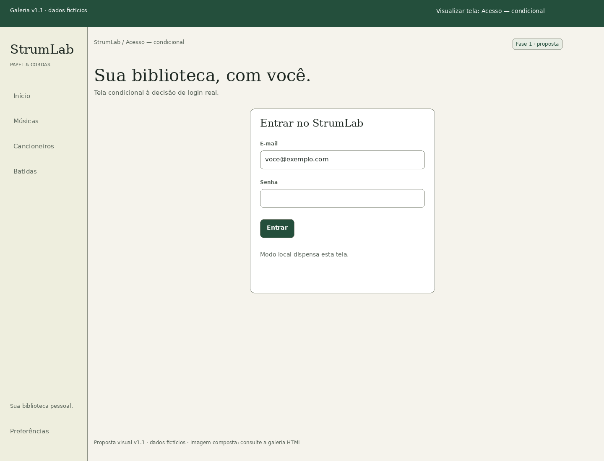

**Objetivo:** Entrar na biblioteca privada. **Fase:** 1. **Ação principal:** Entrar.

Somente se login real for aprovado. Formulário rotulado, erro sem expor detalhes da conta, recuperação conforme provedor escolhido.

**Regras e estados:** Modo local dispensa esta tela. Publicação multiusuário exige autorização e isolamento testado.

## 14. Estados e recuperação

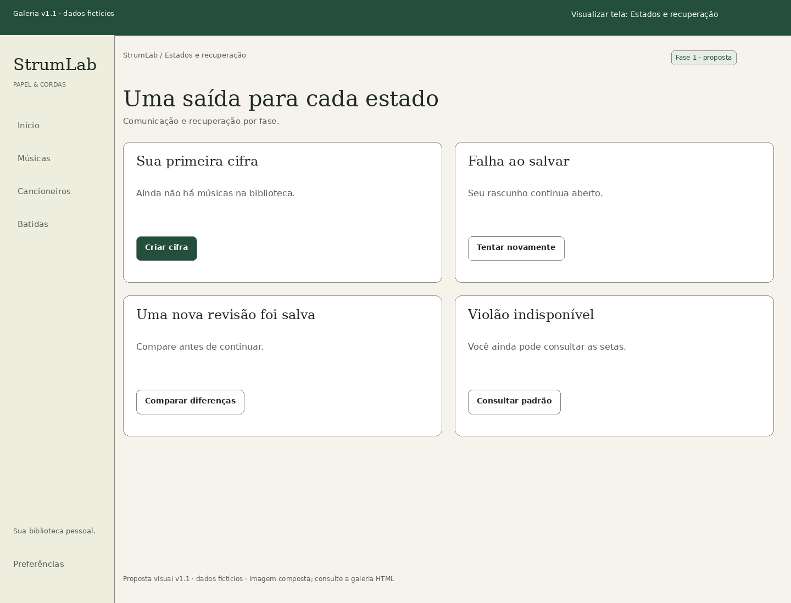

**Objetivo:** Entender e corrigir uma interrupção. **Fase:** 1. **Ação principal:** Tentar novamente.

Galeria de biblioteca vazia, salvamento em erro, conflito de revisão e amostras indisponíveis; exemplos para implementação proporcional à fase.

**Regras e estados:** Foco vai à mensagem quando necessário; live region discreta; rascunho preservado e recuperação acionável.

## Adaptação ao celular

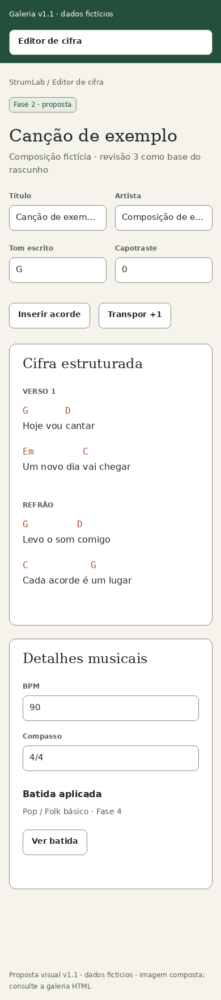
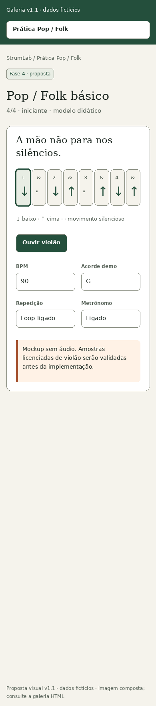
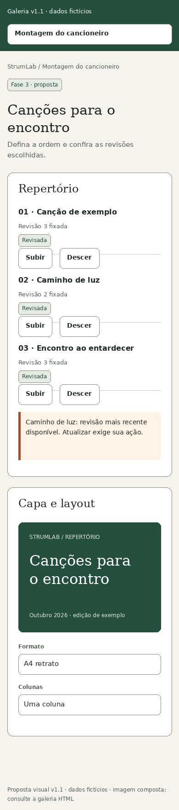

Editor: metadados e ferramentas quebram em linhas; seções e detalhes empilhados, sem acorde depender de espaços. Prática: oito slots cabem horizontalmente; BPM, volumes e acorde em linhas separadas. Montagem: ordem por botões disponíveis sem arrastar; revisão e ações por item empilhadas.

## Critérios de UX por jornada

1. Nova cifra → editar → salvar → ler: posição dos acordes, Unicode, revisão e estados de persistência corretos.
2. Biblioteca → livro → ordem → prévia → PDF: mesmas revisões, páginas calculadas, fonte legível e snapshot de batida consistente.
3. Batidas → Pop/Folk → BPM → ouvir → aplicar: clocks corretos e estado audível/visual coerente; sem autoplay.
4. Análise futura → selecionar → aplicar: apenas seleção gera revisão; resultado rejeitado continua separado.
5. Playlist futura → escolher → resolver pendências: ordem preservada e erro individual não bloqueia todo o lote.
