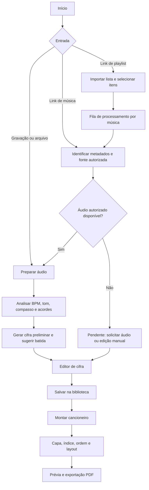

# Plataforma de Cifras e Cancioneiros — Documentação Inicial

**Versão:** 0.2 — Planejamento atualizado em 13/10/2026  
**Finalidade:** referência para desenvolvimento incremental com Codex.  
**Estado:** proposta; nenhuma implementação presumida.

## 1. Visão geral

Aplicação web responsiva, preferencialmente PWA, para transformar gravações ou arquivos de música em cifras de violão editáveis, sugerir batidas e ritmos e organizar músicas em cancioneiros exportáveis em PDF. Em etapa posterior, permitir importar um link de playlist e preparar um cancioneiro com suas músicas.

### Objetivos
- Reduzir o trabalho manual de identificar acordes, tom e andamento.
- Oferecer editor para corrigir resultados automáticos.
- Criar biblioteca pessoal de músicas.
- Montar cancioneiros com capa, índice, ordem e impressão.
- Processar playlists em lote, com acompanhamento de status por música.

### Fora do escopo inicial
- Transcrição perfeita de violão, dedilhados e solos.
- Aplicativos nativos Android/iOS.
- Download irrestrito de áudio de plataformas de streaming.
- Obtenção automática de letras sem autorização.

## 2. Perfis e jornadas

**Usuário individual:** envia áudio, obtém análise, revisa a cifra e salva na biblioteca.  
**Organizador:** seleciona músicas existentes, define ordem e gera cancioneiro.  
**Importador de playlist:** informa URL, visualiza itens, seleciona músicas, fornece fontes de áudio autorizadas quando necessário, revisa resultados e gera cancioneiro.

## 3. Fluxo funcional



## 4. Requisitos funcionais

| ID | Requisito | Prioridade |
|---|---|---|
| RF01 | Enviar arquivos MP3/WAV e gravar áudio | MVP |
| RF02 | Detectar tonalidade e BPM | MVP |
| RF03 | Identificar sequência aproximada de acordes com marcação temporal | MVP |
| RF04 | Criar e editar cifra manualmente | MVP |
| RF05 | Salvar e consultar biblioteca musical | MVP |
| RF06 | Transpor tom e registrar capo | MVP |
| RF07 | Criar cancioneiro com músicas ordenadas | MVP |
| RF08 | Exportar PDF com capa e índice | MVP |
| RF09 | Sugerir batida com indicação de que é estimativa | Pós-MVP |
| RF10 | Importar metadados de playlist por integração autorizada | Pós-MVP |
| RF11 | Processar playlist em fila, com status e reprocessamento | Pós-MVP |
| RF12 | Simplificar acordes e exibir diagramas | Pós-MVP |
| RF13 | Sincronizar acordes com reprodução autorizada | Futuro |
| RF14 | Gerar notas/tablaturas aproximadas | Futuro |
| RF15 | Biblioteca de batidas por estilo, dificuldade e compasso | Fase 4 |
| RF16 | Reprodução demonstrativa com timbre de violão, BPM ajustável e metrônomo | Fase 4 |
| RF17 | Animar setas sincronizadas com o áudio e permitir repetição | Fase 4 |
| RF18 | Aplicar uma batida a uma música e exibi-la no PDF | Fases 4–5 |

**Regra:** análise automática produz sugestões; usuário pode revisar tudo antes de publicar/exportar.

## 5. Requisitos não funcionais

- Interface responsiva para desktop e celular.
- Separação entre interface, API e processamento de áudio.
- Processamento assíncrono para arquivos longos e playlists.
- Status de tarefa: `pending`, `processing`, `completed`, `failed`, `needs_input`.
- Validação de tamanho, duração, formato e conteúdo de arquivos.
- Controle de acesso à biblioteca pessoal; autenticação pode ser introduzida antes de oferecer contas públicas.
- Tratamento de falhas, tentativas limitadas e logs sem dados sensíveis.
- Testes automatizados e documentação dos endpoints.
- Respeito a licenças de áudio, letras e cifras; política de retenção/exclusão de uploads.

## 6. Arquitetura proposta (a validar na fase 1)

- **Frontend:** Next.js + React + TypeScript, com layout PWA.
- **API:** Java Spring Boot ou Node.js; escolher uma opção no início e documentar a decisão.
- **Serviço de áudio:** Python + FastAPI, FFmpeg e bibliotecas de análise musical como Essentia/librosa.
- **Banco:** PostgreSQL.
- **Arquivos:** storage de objetos para uploads e PDFs.
- **Fila:** worker assíncrono com persistência de jobs; selecionar tecnologia conforme volume.
- **Exportação:** modelo de cifra estruturado, com compatibilidade planejada com ChordPro e geração de PDF.

```text
Frontend (Next.js)
   └── API principal
         ├── PostgreSQL
         ├── Storage
         ├── Serviço de cancioneiro/PDF
         └── Fila de jobs
               └── Worker Python (análise de áudio)
```

## 7. Modelo de dados inicial

**User:** id, nome, email, criado_em.  
**Song:** id, owner_id, titulo, artista, tom, bpm, compasso, capo, batida_sugerida, status, criado_em.  
**SongSection:** id, song_id, tipo (`intro`, `verse`, `chorus`, `bridge`, `outro`), ordem, conteudo_estruturado.  
**ChordEvent:** id, song_id, inicio_ms, fim_ms, acorde, confianca.  
**AudioAsset:** id, song_id, storage_key, formato, duracao, origem, permissao_uso, status.  
**Songbook:** id, owner_id, titulo, subtitulo, configuracao_capa, configuracao_layout.  
**StrummingPattern:** id, nome, estilo, dificuldade, compasso, bpm_padrao, subdivisoes_json, acentos_json, abafamentos_json, versao.  
**SongStrummingPattern:** song_id, pattern_id, bpm_personalizado, observacoes, alteracoes_json.  
**SongbookItem:** id, songbook_id, song_id, ordem, observacoes.  
**PlaylistImport:** id, owner_id, plataforma, url, titulo, status.  
**PlaylistImportItem:** id, import_id, posicao, titulo, artista, external_id, song_id, status, erro.  
**ProcessingJob:** id, tipo, referencia_id, status, progresso, tentativas, erro, criado_em, finalizado_em.

**Observação:** letra e cifras de terceiros devem ter origem/licença registradas; não pressupor direitos de redistribuição.

## 8. Etapas de desenvolvimento para Codex

### Fase 1 — Fundação
**Tarefas:** inicializar repositório; configurar frontend, API e PostgreSQL; organizar variáveis de ambiente; criar migrations; adicionar testes básicos, lint e README.  
**Entrega:** aplicação sobe localmente e consulta endpoint de saúde.  
**Aceite:** ambiente reproduzível, sem credenciais no código, testes iniciais passando.

### Fase 2 — Biblioteca e edição manual
**Tarefas:** CRUD de músicas; cadastro de tom, BPM, compasso e capo; editor de seções, letra e acordes; persistência.  
**Entrega:** usuário consegue criar e editar uma cifra sem IA.  
**Aceite:** dados persistem e reabrem sem perda; transposição preserva estrutura.

### Fase 3 — Análise de áudio
**Tarefas:** upload validado; job assíncrono; extração/normalização com FFmpeg; estimativa de BPM, tom e acordes; salvar resultados e nível de confiança; permitir correções.  
**Entrega:** arquivo vira cifra preliminar editável.  
**Aceite:** falhas e formatos inválidos têm mensagens claras; processamento não bloqueia API; resultados são marcados como estimativas.

### Fase 4 — Recursos para violão e Biblioteca de Batidas
**Tarefas:** transposição, capo, diagramas; catálogo de batidas por estilo/compasso/dificuldade; visualização de setas (↓, ↑, pausa e abafamento); metrônomo; ajuste de BPM; loop; reprodução com **timbre de violão**, preferencialmente por amostras de cordas/rasgueados com licença adequada; destaque animado sincronizado; escolha de acorde G, C, D ou Em para demonstração; vincular batida à música.  
**Entrega:** cifra prática e biblioteca interativa para aprender batidas.  
**Aceite:** áudio, metrônomo e animação compartilham o mesmo relógio; controles de pausar/reiniciar funcionam; o som se aproxima de um violão real; há fallback quando amostras não carregam; usuário ajusta e aplica uma batida; sugestão não é apresentada como transcrição exata.

**Ordem interna:** 4A catálogo/JSON e interface → 4B motor de áudio com amostras de violão → 4C agendamento, metrônomo e animação → 4D aplicação à música e persistência. **Não utilizar osciladores simples como timbre final:** a síntese de triângulo usada no protótipo anterior serve apenas de prova de conceito.

### Fase 5 — Cancioneiro e PDF
**Tarefas:** criar coleções, ordenar músicas, configurar capa/índice/layout A4, prévia e exportação PDF; incluir opcionalmente o padrão de batida com setas, legenda e BPM em cada música.  
**Entrega:** cancioneiro imprimível.  
**Aceite:** PDF respeita ordem, quebras de página e legibilidade; nenhuma música é perdida na exportação.

### Fase 6 — Importação de playlists
**Tarefas:** integrar provedores por APIs oficiais; importar metadados e ordem; permitir seleção; criar itens/jobs; solicitar áudio autorizado quando ausente; permitir revisar pendências; adicionar músicas processadas ao cancioneiro.  
**Entrega:** fluxo de playlist para cancioneiro.  
**Aceite:** importar playlist não significa baixar áudio; falha em uma música não interrompe as demais; usuário pode exportar itens prontos e resolver pendências depois.

### Fase 7 — Evoluções opcionais
**Tarefas:** detecção de seções, reprodução sincronizada, separação de instrumentos, notas e tablaturas, compartilhamento de cancioneiros, colaboração.  
**Entrega:** módulos incrementais sujeitos a validação técnica e jurídica.

## 9. Regras de negócio essenciais

1. **Uma música, vários cancioneiros:** Song é independente de Songbook; SongbookItem define associação e ordem.
2. **Não sobrescrever correções:** reprocessar áudio deve criar versão/resultado comparável, preservando alterações manuais.
3. **Playlist não é áudio:** URL pode fornecer somente metadados; análise depende de áudio obtido de forma autorizada.
4. **Falha isolada:** erro em uma faixa não cancela toda a importação.
5. **Exportação parcial:** itens pendentes devem ser destacados e excluídos ou tratados manualmente antes do PDF final.
6. **Batida sugerida:** baseada em heurísticas ou análise, não garantia de reprodução fiel.
7. **Direitos autorais:** não implementar scraping indiscriminado de letras, download não autorizado ou distribuição automática de obras protegidas.
8. **Limites operacionais:** limitar duração, tamanho, quantidade de jobs e concorrência por usuário.

## 10. Padrão de execução com Codex

Para cada fase:
1. Ler este documento, README, estrutura atual e decisões técnicas registradas.
2. Inspecionar código existente antes de sugerir mudanças.
3. Elaborar plano curto com arquivos afetados, regras e testes.
4. Implementar somente a fase solicitada, sem antecipar módulos futuros.
5. Criar/ajustar migrations, validações, testes e documentação.
6. Executar verificações disponíveis e relatar resultados reais.
7. Encerrar com resumo de arquivos alterados, decisões, pendências e próximo passo.

### Modelo de prompt para Codex

```markdown
Implemente a Fase [NOME] da documentação `documentacao_projeto_cifras_cancioneiros.md`.

Antes de alterar o código:
- Leia a documentação, README e convenções existentes.
- Inspecione a arquitetura e reutilize componentes/serviços já implementados.
- Liste brevemente o plano, os riscos e os critérios de aceite.

Durante a implementação:
- Respeite as regras de negócio e o escopo da fase.
- Não crie integrações externas fictícias nem presuma acesso a APIs.
- Preserve compatibilidade e dados existentes.
- Inclua tratamento de erros, validação e testes relevantes.

Ao terminar:
- Execute testes e lint disponíveis.
- Informe o que foi implementado, arquivos alterados, comandos de execução,
  testes executados, limitações e próximos passos.
- Atualize a documentação se decisões técnicas mudarem.
```

## 11. Primeiras decisões pendentes

- Backend principal: Spring Boot ou Node.js?
- Login desde o MVP ou protótipo local com usuário único?
- Limites iniciais de duração/tamanho de áudio?
- Provedor de storage e mecanismo de jobs?
- Fontes autorizadas para letras e links de música?
- Estratégia de PDF: ChordPro CLI, biblioteca dedicada ou renderização própria?

## 12. Definição de sucesso do MVP

Um usuário consegue enviar um arquivo musical, receber acordes/tom/BPM aproximados, corrigir a cifra, salvar músicas, organizá-las em um cancioneiro e exportar um PDF legível. A importação de playlists é a evolução prioritária após estabilizar esse fluxo.


## 13. Biblioteca de Batidas — especificação de implementação

### Experiência do usuário
- Aba **Modelos de batida** no menu principal e acesso contextual pelo editor da música.
- Lista com pesquisa e filtros por estilo (Pop/Folk, Rock, Reggae, Balada, Sertanejo, Samba, Bossa Nova etc.), compasso e dificuldade.
- Ao selecionar um modelo: exibir nome, BPM padrão, compasso, subdivisões, setas, pausas, abafamentos e acentuação; botão Reproduzir/Pausar, Reiniciar, loop, metrônomo e controle de BPM.
- Realçar a subdivisão atual no mesmo instante da batida ou movimento de mão; movimentos silenciosos continuam aparecendo na animação.
- Seleção de acorde para demonstração, inicialmente G, C, D e Em; botão **Aplicar à música** quando houver música aberta.
- Na exportação, incluir representação textual/visual das setas, BPM, compasso e legenda; não incluir áudio no PDF.

### Modelo inicial: Pop / Folk
- Nome: `Pop / Folk básico`; dificuldade: iniciante; compasso: `4/4`; BPM padrão: `90` (ajustável, inicialmente 45–160).
- Grade de oito colcheias: `1 & 2 & 3 & 4 &`.
- Movimentos: `↓ · ↓ ↑ · ↑ ↓ ↑` (`·` = movimento sem atacar as cordas).
- Observação: as seis setas audíveis formam a sequência `↓ ↓↑ ↑↓↑`; os espaços precisam ser preservados para a sincronização.
- O padrão é um modelo didático, não uma transcrição fiel de uma gravação específica.

### Estratégia de áudio (prioridade para timbre de violão)
1. Preferir **amostras reais de violão** (cordas ou rasgueados down/up, e opcionalmente abafamento) de origem e licença documentadas; armazená-las como assets versionados, otimizados para carregamento rápido.
2. Implementar motor no navegador com **Web Audio API** e `AudioBufferSourceNode` para disparar amostras; usar o relógio de `AudioContext.currentTime` e agendamento antecipado (*look-ahead*) para reduzir instabilidade.
3. Para mudança de acorde, usar amostras por acorde ou combinação de notas amostradas com voicings realistas. Evitar prometer realismo perfeito a partir de uma única amostra transposta.
4. Metrônomo com clique discreto e acento no primeiro tempo, mixagem/volume independentes do violão e opção de desligar.
5. Atualização das setas por animação sincronizada ao tempo agendado do áudio, considerando latência e retomada do contexto de áudio. Não depender exclusivamente de `setTimeout` para determinar o instante sonoro.
6. Tratar bloqueio de autoplay (som apenas após gesto do usuário), indisponibilidade de assets, pausa/retomada, mudança de BPM e limpeza de recursos.
7. Fallback: amostras alternativas mais leves ou síntese provisória **explicitamente identificada**, nunca confundida com o timbre final do produto.

### Estrutura sugerida do padrão
```json
{
  "id": "pop-folk-basic",
  "name": "Pop / Folk básico",
  "timeSignature": "4/4",
  "defaultBpm": 90,
  "subdivisionsPerBar": 8,
  "events": [
    {"slot": 0, "direction": "down", "play": true, "accent": true},
    {"slot": 1, "direction": "up", "play": false},
    {"slot": 2, "direction": "down", "play": true},
    {"slot": 3, "direction": "up", "play": true},
    {"slot": 4, "direction": "down", "play": false},
    {"slot": 5, "direction": "up", "play": true},
    {"slot": 6, "direction": "down", "play": true},
    {"slot": 7, "direction": "up", "play": true}
  ]
}
```

### Testes de aceite específicos
- Com 90 BPM, cada colcheia dura aproximadamente 333,33 ms e o compasso 4/4 dura aproximadamente 2,667 s.
- Metrônomo acentua o primeiro dos quatro tempos; animação exibe os oito movimentos, inclusive silenciosos.
- Pausar/reiniciar não deixa sons agendados ou setas fora de sincronia; alterar BPM não cria duas reproduções simultâneas.
- A troca de acorde afeta o áudio seguinte e não altera o padrão rítmico.
- Assets têm licença registrada; sem áudio disponível, interface apresenta mensagem e fallback seguro.
- A batida selecionada persiste na música e sua representação aparece corretamente no PDF quando habilitada.

## 14. Roteiro para início do desenvolvimento — 14/10/2026

**Sessão inicial (Fase 1, sem antecipar análise musical):**
1. Criar repositório e adicionar esta documentação em `docs/planejamento.md` ou manter o nome atual na raiz.
2. Pedir ao Codex inspeção do repositório e proposta de arquitetura; registrar escolha de backend (Spring Boot ou Node), banco e organização do monorepo.
3. Inicializar frontend Next.js/TypeScript e backend escolhido; criar `README.md`, `.env.example`, `.gitignore` e scripts de execução.
4. Configurar PostgreSQL local (por exemplo, Docker Compose), migrations e endpoint `/health`.
5. Criar navegação com telas vazias: Biblioteca, Músicas, Modelos de Batida, Cancioneiros, Importar Playlist; usar dados de demonstração identificados como mock.
6. Rodar build, lint e testes; registrar decisões e pendências antes da Fase 2.

**Marco seguinte:** concluir CRUD de músicas e editor manual; só então integrar análise automática e o motor de áudio realista da Biblioteca de Batidas.

### Prompt de partida para Codex
```markdown
Leia integralmente `documentacao_projeto_cifras_cancioneiros.md` (ou `docs/planejamento.md`), especialmente as seções 8, 13 e 14. Vamos iniciar a Fase 1.

Antes de codificar, inspecione o repositório, apresente uma proposta breve de arquitetura e liste decisões técnicas que dependam de mim. Após resolver as decisões bloqueantes, implemente somente a fundação do projeto: frontend, backend, PostgreSQL, estrutura de pastas, migrations iniciais, endpoint de saúde, navegação das telas e documentação de execução.

Não implemente ainda processamento de áudio, integrações de playlists nem o player definitivo. Preserve no planejamento a Biblioteca de Batidas com amostras de violão realistas, metrônomo, setas sincronizadas e aplicação à cifra. Use dados mockados somente quando claramente identificados. Execute os testes disponíveis, descreva arquivos alterados e informe o próximo passo.
```
